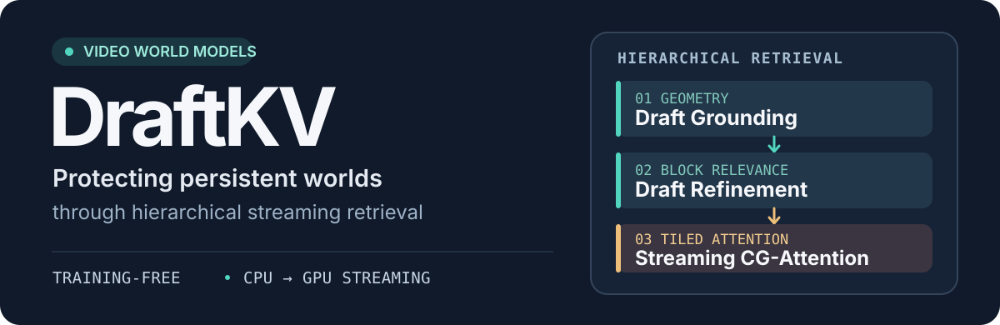
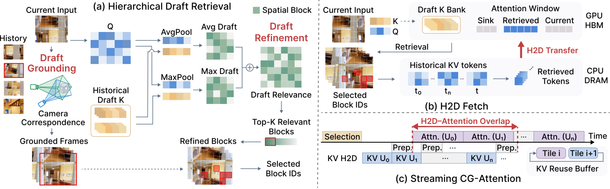

<p align="center">
  
</p>

<p align="center"><strong>English</strong> · <a href="docs/README_CN.md">简体中文</a></p>

DraftKV improves scene revisit consistency in video generation by retrieving relevant historical KV caches through **Draft Grounding** and **Draft Refinement**, while **Streaming CG-Attention** overlaps CPU-to-GPU KV transfers with attention computation to hide transfer latency. The entire framework requires no model retraining.

<p align="center">
  
</p>

## Quick Start

**Requirements:** Linux x86_64, an NVIDIA CUDA GPU, compatible NVIDIA drivers and CUDA Toolkit, Python 3.10, Conda, Git, and network access. **Each base model should use a separate Conda environment** to avoid conflicts between pinned dependency versions. FlashAttention 3 (FA3) is automatically selected for Hopper SM90 GPUs, while FlashAttention 2 (FA2) is selected for other GPU architectures, including the RTX 5090.

```bash
git clone https://github.com/TillyEndless/DraftKV.git
cd DraftKV

conda create -n draftkv python=3.10 pip -y
conda activate draftkv
```

### LingBot-World 1.3B Example: Setup → Generation → Evaluation

The following example uses **LingBot-World 1.3B**, **GPU 0**, and the default external cache paths. Run all commands from the repository root with the `draftkv` Conda environment activated.

**1. Prepare the model, benchmark inputs, and evaluation environment.** If the ORBIA dataset requires access authorization, obtain the necessary permissions and authenticate using `hf auth login` before proceeding.

```bash
export DRAFTKV_ASSETS="$HOME/.cache/draftkv/assets"
export DRAFTKV_ENVS="$HOME/.cache/draftkv-install"
export DEMO_RUN="$DRAFTKV_ASSETS/demo/lingbot1.3b"

./scripts/reproduce.sh setup \
  --model lingbot1.3b --gpu 0 \
  --asset-root "$DRAFTKV_ASSETS" \
  --env-root "$DRAFTKV_ENVS"
```

**2. Generate a video from an ORBIA case.** If no case is specified, `infer` selects the first **previously prepared** ORBIA request; it does not generate a demo request from downloaded model assets. Setup must first complete the authorized ORBIA request preparation. The output directory must **not already exist**; do not create `$DEMO_RUN` beforehand. Use a different `DEMO_RUN` path for subsequent runs.

```bash
./scripts/reproduce.sh infer \
  --model lingbot1.3b --gpu 0 --profile off \
  --asset-root "$DRAFTKV_ASSETS" \
  --env-root "$DRAFTKV_ENVS" \
  --output "$DEMO_RUN/video.mp4"
```

**3. Evaluate with WBench/DA3.** First estimate depth and camera parameters, then compute reprojection PSNR, Masked SSIM, and LPIPS.

```bash
conda run -n draftkv-wbench-eval python \
  "$DRAFTKV_ASSETS/evaluation/WBench/tools/run_da3_depth.py" \
  --video "$DEMO_RUN/video.mp4" \
  --output_dir "$DEMO_RUN/da3" \
  --fps 3

python3 scripts/evaluate.py table3 \
  --asset-root "$DRAFTKV_ASSETS" \
  --video "$DEMO_RUN/video.mp4" \
  --da3-cache "$DEMO_RUN/da3" \
  --output "$DEMO_RUN/table3.json" \
  --gpu 0
```

On a successful run, the video is saved as `video.mp4` and the evaluation scores as `table3.json`. This single-case example is not a full reproduction of the paper results. CUDA/C++ extensions (including B01), model sources, and authorized benchmark inputs must be available; online setup alone does not guarantee end-to-end GPU inference.

### Parameter Reference

| Model | `<model_name>` |
| --- | --- |
| LongLive-1.3B | `longlive1.3b` |
| LingBot-World 1.3B | `lingbot1.3b` |
| LingBot-World 14B | `lingbot14b` |
| SolarWM-33B | `solarwm33b` |

### Alternative Setup Methods (Optional)

**One-command environment and asset preparation:** Installs model dependencies, downloads available model weights and benchmark inputs from pinned upstream sources, and prepares isolated evaluation environments.

```bash
./scripts/reproduce.sh setup \
  --model <model_name> \
  --gpu <gpu_id> \
  --env-root <env_root> \
  --asset-root <asset_root>
```

### Step-by-Step Installation (Optional)

To install Python dependencies and download model/dataset assets separately:

```bash
./scripts/draftkv.sh environment \
  --model <model_name> \
  --python "$(which python)"

./scripts/draftkv.sh assets \
  --model <model_name> \
  --asset-root <asset_root> \
  --with-dataset
```

Alternatively, use the lower-level `bootstrap` command to initialize the environment and download assets in a single step:

```bash
./scripts/draftkv.sh bootstrap \
  --model <model_name> \
  --env-root <env_root> \
  --asset-root <asset_root> \
  --gpu <gpu_id> \
  --with-dataset
```

Python dependencies are installed into the currently activated Conda environment. CUDA extension build artifacts and installation records are stored under `~/.cache/draftkv-install/<model_name>/` by default, while model weights and datasets are stored under `~/.cache/draftkv/assets/`.

Use `--env-root` and `--asset-root` to specify alternative external storage locations. Previously verified downloads are automatically reused, and interrupted downloads can be resumed when supported by the server.

## Video Generation and Profiling

**Single-case inference:** By default, the command runs the first prepared case. Use `--case-id <case_id>` to select a different case.

```bash
./scripts/reproduce.sh infer \
  --model <model_name> \
  --gpu <gpu_id> \
  --profile off \
  --env-root <env_root> \
  --asset-root <asset_root>
```

Set `--profile on` when using the high-level `reproduce.sh infer` interface to enable profiling diagnostics.

**Explicit input and output paths:** The lower-level `draftkv.sh run` command accepts a prepared and verified `request.json` or an inference plan following the original schema. Use `--profile on` to enable diagnostics.

```bash
./scripts/draftkv.sh run \
  --model <model_name> \
  --env-root <env_root> \
  --asset-root <asset_root> \
  --input <input_path> \
  --output <output_path> \
  --gpu <gpu_id> \
  --profile off
```

Changing `--profile off` to `--profile on` enables a deployment profiling summary. The original low-level interface can also be inspected using `./run.sh --help`, but it requires a separately prepared execution plan following the original schema, along with the corresponding external dependencies.

### ORBIA Batch Inference

For LingBot-World 1.3B/14B and SolarWM-33B, use `--all` to run inference on all cases in the dataset.

```bash
./scripts/reproduce.sh infer \
  --model <model_name> \
  --gpu <gpu_id> \
  --profile off \
  --all \
  --env-root <env_root> \
  --asset-root <asset_root> \
  --output-dir <batch_output_dir>
```

Each case and retry uses a separate output directory. Execution progress is recorded in `batch.json`. By default, the process stops on the first failure. Use `--keep-going` to continue processing the remaining cases.

To resume an interrupted batch, use the **same model, GPU, profiling options, and asset/environment paths**:

```bash
./scripts/reproduce.sh infer \
  --model <model_name> \
  --gpu <gpu_id> \
  --profile off \
  --all --resume \
  --env-root <env_root> \
  --asset-root <asset_root> \
  --output-dir <batch_output_dir>
```

Use `--dry-run` to preview the commands without generating videos.

## Evaluation

Evaluation can be performed separately from inference using isolated evaluator environments. The setup procedure prepares accessible official evaluators and their weights. End-to-end GPU validation is still required to establish whether the paper's reported results can be reproduced.

### ORBIA Evaluation

```bash
python3 scripts/evaluate.py table2 \
  --asset-root <asset_root> \
  --videos <generated_videos_path> \
  --output <evaluation_output_dir> \
  --gpu <gpu_id>
```

### WBench/DA3 Reprojection

First, generate the DA3 geometry cache using the official WBench preprocessing implementation:

```bash
conda run -n draftkv-wbench-eval python \
  <asset_root>/evaluation/WBench/tools/run_da3_depth.py \
  --video_dir <generated_videos_dir> \
  --output_base <da3_cache_dir> \
  --gpus <gpu_id> --fps 3
```

Then evaluate an individual generated case:

```bash
python3 scripts/evaluate.py table3 \
  --asset-root <asset_root> \
  --video <video_path> \
  --da3-cache <case_da3_cache_dir> \
  --output <metrics_output_json> \
  --gpu <gpu_id>
```

Project-owned code is licensed under [Apache-2.0](LICENSE). Third-party datasets, pretrained model weights, and source code remain subject to their respective licenses. The ORBIA dataset is licensed under **CC-BY-NC-SA-4.0**. See [Third-Party Notices](docs/THIRD_PARTY_NOTICES.md) for details.
