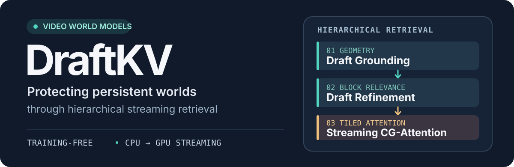
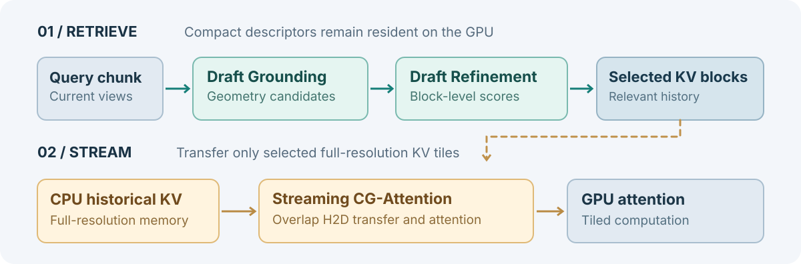

<p align="center">
  
</p>

<p align="center">
  <a href="README.md">English</a> · <a href="README_CN.md"><strong>简体中文</strong></a> ·
  <a href="#工作原理">工作原理</a> · <a href="#快速开始">快速开始</a> ·
  <a href="#文档">文档</a>
</p>

**DraftKV** 是面向持久化长视频生成与交互式世界模型的**免训练历史 KV 检索框架**。它无需将全部历史 KV 常驻 GPU，即可找回与当前生成相关的历史上下文，并将选中的 KV Blocks 流式送入 Attention。

## 工作原理

<p align="center">
  
</p>

1. **Draft Grounding：** 利用相机视锥和几何对应关系，从历史中筛选空间相关的候选范围。
2. **Draft Refinement：** 利用紧凑的 Draft Attention 对候选 KV Blocks 评分，进一步选出与当前 Query 相关的历史。
3. **Streaming CG-Attention：** 将所选全分辨率 KV 的 CPU→GPU 分块传输与 Attention 计算重叠执行。

用于检索的 **Persistent Draft Bank** 常驻 GPU，全分辨率历史 KV 保存在 CPU 内存中。整个流程**无需重新训练模型**。

## 快速开始

**环境要求：** Linux x86_64、配备可用驱动及兼容 CUDA Toolkit/编译工具链的 NVIDIA GPU，以及 Git、curl 和 Conda。

```bash
git clone https://github.com/TillyEndless/DraftKV.git
cd DraftKV

conda create -n draftkv python=3.10 pip -y
conda activate draftkv

./scripts/draftkv.sh bootstrap --backbone lingbot1.3b --with-dataset
```

上述命令将准备固定版本的 Python 环境、可获取的模型/数据资产及按 GPU 架构选择的 FlashAttention 依赖。安装器**直接使用当前激活的 Conda 环境**，不会再创建嵌套虚拟环境。不同 Backbone 应使用独立 Conda 环境。

如需复用已有模型文件或调整下载目录，可指定 `--asset-root /path/to/assets`；安装缓存可通过 `--env-root /path/to/cache` 指定。安装器会校验并复用 SHA-256 匹配的文件。

Native 构建、推理输入准备和视频生成步骤见[完整安装文档](docs/INSTALL_CN.md)及[详细 Quickstart](docs/QUICKSTART_CN.md)。

## 支持的 Backbone

| 模型 | `--backbone` | 源码目录 |
| --- | --- | --- |
| LongLive-1.3B | `longlive1.3b` | [`versions/longlive`](versions/longlive) |
| LingBot-World 1.3B | `lingbot1.3b` | [`versions/lingbot13`](versions/lingbot13) |
| LingBot-World 14B | `lingbot14b` | [`versions/h200_large`](versions/h200_large) |
| SolarWM-33B | `solarwm33b` | [`versions/h200_large`](versions/h200_large) |

将 bootstrap 命令中的 `lingbot1.3b` 替换为相应标识即可。完整参数可通过 `./scripts/draftkv.sh bootstrap --help` 查看。Hopper SM90（H100/H200）可在模型原生 FA2 依赖之外额外编译 FA3；其他受支持的 NVIDIA GPU 使用 FA2。

## 文档

- **[安装说明](docs/INSTALL_CN.md)** — 环境、模型资产与 Native 依赖。
- **[Quickstart](docs/QUICKSTART_CN.md)** — 输入准备与推理流程。
- **[Profiling](docs/PROFILING_CN.md)** — 性能测量入口及说明。
- **[第三方许可声明](docs/THIRD_PARTY_NOTICES.md)** — 上游组件及许可证。

统一入口为 [`scripts/draftkv.sh`](scripts/draftkv.sh)。各 Backbone 的源码快照位于 [`versions/`](versions)，离线检查位于 [`tests/`](tests)。

## 许可证与致谢

项目自有代码采用 [Apache-2.0](LICENSE) 许可证；第三方源码、模型权重和数据集遵循各自的授权与访问条款，详见[第三方许可声明](docs/THIRD_PARTY_NOTICES.md)。

DraftKV 基于 [LongLive](https://github.com/NVlabs/LongLive)、[LingBot-World](https://github.com/Robbyant/lingbot-world-v2) 和 [SolarWM](https://github.com/Junchao-cs/SolarWM) 等模型体系构建。
