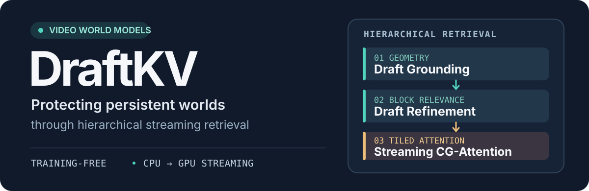
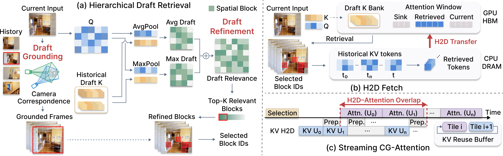

<p align="center">
  
</p>

<p align="center"><a href="../README.md">English</a> · <strong>简体中文</strong></p>

<p align="center"><a href="https://arxiv.org/abs/2611.31944"></a></p>

DraftKV 通过 **Draft Grounding** 与 **Draft Refinement** 检索相关历史 KV Cache，提高视频生成中的场景回访一致性；通过 **Streaming CG-Attention** 将 CPU→GPU KV 传输时间隐藏在 Attention 计算当中。整个框架无需重新训练模型。

<p align="center">
  
</p>

## 快速开始

**环境要求：** Linux x86_64、NVIDIA CUDA GPU、兼容的 NVIDIA 驱动与 CUDA Toolkit、Python 3.10，以及 Conda、Git 和网络连接。**不同基础模型应使用独立 Conda 环境**，避免固定版本的依赖冲突。Hopper SM90 自动选择 FlashAttention 3（FA3），其他 GPU 架构（包括 RTX 5090）选择 FlashAttention 2（FA2）。

```bash
git clone https://github.com/TillyEndless/DraftKV.git
cd DraftKV

conda create -n draftkv python=3.10 pip -y
conda activate draftkv
```

### LingBot-World 1.3B 示例：部署 → 生成 → 评测

下面以 **LingBot-World 1.3B**、**GPU 0** 和默认外部缓存路径为例。在已激活的 `draftkv` Conda 环境中、于仓库根目录执行。

**1. 准备模型、基准输入和评估环境。** 若 ORBIA 数据集需要访问授权，请先获取权限并运行 `hf auth login` 完成认证。

```bash
export DRAFTKV_ASSETS="$HOME/.cache/draftkv/assets"
export DRAFTKV_ENVS="$HOME/.cache/draftkv-install"
export DEMO_RUN="$DRAFTKV_ASSETS/demo/lingbot1.3b"

./scripts/reproduce.sh setup \
  --model lingbot1.3b --gpu 0 \
  --asset-root "$DRAFTKV_ASSETS" \
  --env-root "$DRAFTKV_ENVS"
```

**2. 在 ORBIA Case 上推理生成视频。** 不指定案例时，`infer` 会选择**已经准备好的第一个** ORBIA 请求，并不会仅凭下载的模型资产自动生成 demo 输入。需要先成功完成已授权的 ORBIA 请求准备。输出目录必须是**尚未存在的新目录**；请勿提前创建 `$DEMO_RUN`，重复运行时需更换路径。

```bash
./scripts/reproduce.sh infer \
  --model lingbot1.3b --gpu 0 --profile off \
  --asset-root "$DRAFTKV_ASSETS" \
  --env-root "$DRAFTKV_ENVS" \
  --output "$DEMO_RUN/video.mp4"
```

**3. 使用 WBench/DA3 评估**。先生成深度与相机参数，再计算重投影 PSNR、Masked SSIM 和 LPIPS。

```bash
conda run -n draftkv-wbench-eval python \
  "$DRAFTKV_ASSETS/evaluation/WBench/tools/run_da3_depth.py" \
  --video "$DEMO_RUN/video.mp4" \
  --output_dir "$DEMO_RUN/da3" \
  --fps 3

python3 scripts/evaluate.py table3 \
  --asset-root "$DRAFTKV_ASSETS" \
  --video "$DEMO_RUN/video.mp4" \
  --da3-cache "$DEMO_RUN/da3" \
  --output "$DEMO_RUN/table3.json" \
  --gpu 0
```

成功执行后，生成视频位于 `video.mp4`，评分位于 `table3.json`。这是单案例功能验证，不代表完整复现论文结果。运行还需要可用的 CUDA/C++ 扩展（包括 B01）、模型源码和已授权的基准输入；仅完成在线环境准备不等于已验证端到端 GPU 推理。

### 参数参考

| 模型 | `<model_name>` |
| --- | --- |
| LongLive-1.3B | `longlive1.3b` |
| LingBot-World 1.3B | `lingbot1.3b` |
| LingBot-World 14B | `lingbot14b` |
| SolarWM-33B | `solarwm33b` |

### 其他部署方式（可选）

**一键准备环境与资产：** 安装模型依赖，从固定上游来源下载可获得的模型权重和基准输入，并准备独立的评估器环境。

```bash
./scripts/reproduce.sh setup \
  --model <model_name> \
  --gpu <gpu_id> \
  --env-root <env_root> \
  --asset-root <asset_root>
```

### 分步安装（可选）

如果希望分开安装 Python 依赖和下载模型／数据集资产：

```bash
./scripts/draftkv.sh environment \
  --model <model_name> \
  --python "$(which python)"

./scripts/draftkv.sh assets \
  --model <model_name> \
  --asset-root <asset_root> \
  --with-dataset
```

也可以使用底层 `bootstrap` 一次执行环境和资产初始化：

```bash
./scripts/draftkv.sh bootstrap \
  --model <model_name> \
  --env-root <env_root> \
  --asset-root <asset_root> \
  --gpu <gpu_id> \
  --with-dataset
```

Python 依赖安装在当前激活的 Conda 环境中。CUDA 扩展构建产物和安装记录默认存放在 `~/.cache/draftkv-install/<model_name>/`，模型权重与数据集默认存放在 `~/.cache/draftkv/assets/`。可用 `--env-root` 和 `--asset-root` 指定外部存储位置。已完成校验的下载文件会被复用；若服务器支持续传，下载中断后可以恢复。

## 视频生成与 Profiling

**单案例推理：** 默认运行第一个已经准备好的案例；可以通过 `--case-id <case_id>` 指定其他案例。

```bash
./scripts/reproduce.sh infer \
  --model <model_name> \
  --gpu <gpu_id> \
  --profile off \
  --env-root <env_root> \
  --asset-root <asset_root>
```

使用高层入口 `reproduce.sh infer` 时，设为 `--profile on` 可开启 Profiling 诊断。

**指定输入与输出：** 底层 `draftkv.sh run` 接受已经准备并校验的 `request.json` 或符合原始 Schema 的推理计划文件。使用 `--profile on` 启用诊断。

```bash
./scripts/draftkv.sh run \
  --model <model_name> \
  --env-root <env_root> \
  --asset-root <asset_root> \
  --input <input_path> \
  --output <output_path> \
  --gpu <gpu_id> \
  --profile off
```

将底层命令中的 `--profile off` 改为 `--profile on`，可以输出部署诊断摘要。原始低层接口也可通过 `./run.sh --help` 查看，但需要额外准备符合原始 Schema 的运行计划及外部依赖。

### ORBIA 批量推理

对 LingBot-World 1.3B／14B 和 SolarWM-33B，使用 `--all` 按顺序运行全部已准备且经过校验的 ORBIA 案例。

```bash
./scripts/reproduce.sh infer \
  --model <model_name> \
  --gpu <gpu_id> \
  --profile off \
  --all \
  --env-root <env_root> \
  --asset-root <asset_root> \
  --output-dir <batch_output_dir>
```

每个案例、每次重试使用独立输出目录。`batch.json` 记录执行进度；默认遇到失败就停止，可通过 `--keep-going` 继续运行剩余案例。中断后需使用**相同的模型、GPU、Profiling 设置及资产／环境路径**恢复：

```bash
./scripts/reproduce.sh infer \
  --model <model_name> \
  --gpu <gpu_id> \
  --profile off \
  --all --resume \
  --env-root <env_root> \
  --asset-root <asset_root> \
  --output-dir <batch_output_dir>
```

使用 `--dry-run` 可以预览命令而不执行视频生成。

## 评估

评估与推理可以分开执行，并使用独立的评估器环境。初始化会准备可访问的官方评估器及其权重；完整 GPU 评分能否复现论文表格数值，仍需要端到端验收。

### ORBIA 评测

```bash
python3 scripts/evaluate.py table2 \
  --asset-root <asset_root> \
  --videos <generated_videos_path> \
  --output <evaluation_output_dir> \
  --gpu <gpu_id>
```


### WBench/DA3 重投影

首先使用 WBench 官方预处理实现生成 DA3 几何缓存：

```bash
conda run -n draftkv-wbench-eval python \
  <asset_root>/evaluation/WBench/tools/run_da3_depth.py \
  --video_dir <generated_videos_dir> \
  --output_base <da3_cache_dir> \
  --gpus <gpu_id> --fps 3
```

随后评估一个生成案例：

```bash
python3 scripts/evaluate.py table3 \
  --asset-root <asset_root> \
  --video <video_path> \
  --da3-cache <case_da3_cache_dir> \
  --output <metrics_output_json> \
  --gpu <gpu_id>
```


项目自有代码采用 [Apache-2.0](../LICENSE) 许可。第三方数据集、预训练权重及代码保留各自的许可证；ORBIA 数据遵循 **CC-BY-NC-SA-4.0**。详见[第三方许可声明](THIRD_PARTY_NOTICES.md)。
